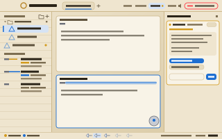
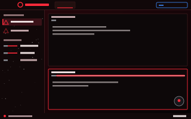

# herdr-star-wars

Two Star Wars-inspired layouts for [Herdr](https://herdr.dev), the desktop app for terminals and coding agents. They change much more than the colors: each one has its own top bar, sidebar, pane headers, status bar, a floating droid and an opening crawl.

| Jedi Archives (light) | Sith Citadel (dark) |
|---|---|
|  |  |

## What you get

- **Lightsaber pane headers.** The blade ignites across the pane you're in and retracts when you leave. A pane whose agent needs you lights up in amber and flickers until you look. Click a hilt to hear it hum.
- **A themed sidebar.** Spaces become holocrons (Jedi) or conquered systems (Sith). Agents become padawans or apprentices, each with a small saber: it swings while the agent works, holds steady when it's done, flickers when it needs you and is off when idle. Each agent also shows its current task, its space and tab, and the folder and git branch it's working in. Double-click a space to rename it.
- **Each side's own words.** Jedi agents are "in training" or "seek your counsel"; Sith agents are "executing orders" or "await your command".
- **A top bar.** Tabs appear as scrolls (Jedi) or fronts (Sith), with a lit blade under the active one. Double-click a tab to rename it and middle-click to close it. **CRAWL** replays the opening crawl, the speaker mutes the saber sounds, and **Join the Dark Side** / **Return to the Light** switches sides.
- **A droid.** It floats at the edge of the window and speaks up when an agent finishes or needs you. The Jedi training sphere talks like an old master; the Sith orb files Imperial reports. Click it for tips, or tell it to power down.
- **An opening crawl.** Each side has its own original story, shown the first time you open that side.
- **A status bar** with agent counts in each side's words, where you are, and a clock.

There's also `themes/star-wars.json`, a colors-only dark theme you can use with any layout, Herdr's default included.

## Install

You need Herdr installed and started at least once.

One line:

```sh
curl -fsSL https://raw.githubusercontent.com/ikentrock/herdr-star-wars/main/install.sh | bash
```

Or from a clone:

```sh
git clone https://github.com/ikentrock/herdr-star-wars.git
cd herdr-star-wars
./install.sh
```

The script copies the files into Herdr's folder (`~/.config/herdr-app`, or `$HERDR_APP_HOME` if you set it). If it would replace any file you've changed, it backs that file up first into a `.herdr-star-wars-backup-<time>` folder there. Herdr picks the new files up while it runs, so there's nothing to restart.

Then open Herdr's **Settings › Layouts** and pick **jedi** or **sith**, or run:

```sh
herdr-app do layout.switch '{"name":"sith"}'
```

To go back to Herdr's default layout, pick **main**.

### Uninstall

```sh
./install.sh --uninstall
```

This switches you back to `main` if you're on one of these layouts, then removes the files.

### Manual install

Copy `layouts/`, `themes/` and `mods/starwars/` into `~/.config/herdr-app/`, keeping the same folder structure.

## Notes

- **Fonts.** The UI uses Optima (Jedi) and Copperplate and Avenir Next (Sith), which come with macOS. On Linux and Windows, Herdr falls back to its own fonts. Terminals use JetBrains Mono, which ships with Herdr.
- **Sounds.** The saber and droid sounds play only for this layout's own actions. Herdr's alerts for a finished or blocked agent are unchanged. The speaker button in the top bar, or turning sounds off in Herdr's settings, silences them.
- **Readability.** Every terminal color in both themes has at least 4.5:1 contrast against its background, so agent output stays readable on the light Jedi theme too.

## Files

```
layouts/jedi.json, sith.json    the two layouts
layouts/jedi.svg, sith.svg      their previews in Herdr's settings
themes/jedi.json, sith.json     each layout's colors
themes/star-wars.json           a colors-only theme for any layout
mods/starwars/                  the mod that draws everything (bar, sidebar,
                                pane header, status bar, droid, crawl), with
                                its art, icons and sounds
install.sh                      install / uninstall
```

## Credits

All art is original SVG and all sounds were synthesized with ffmpeg. Nothing is taken from the films.

This is an unofficial fan project. It isn't affiliated with or endorsed by Lucasfilm, Disney or Herdr. Star Wars is a trademark of Lucasfilm Ltd.

## License

[MIT](LICENSE)
